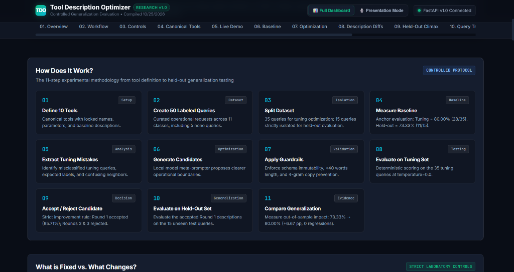
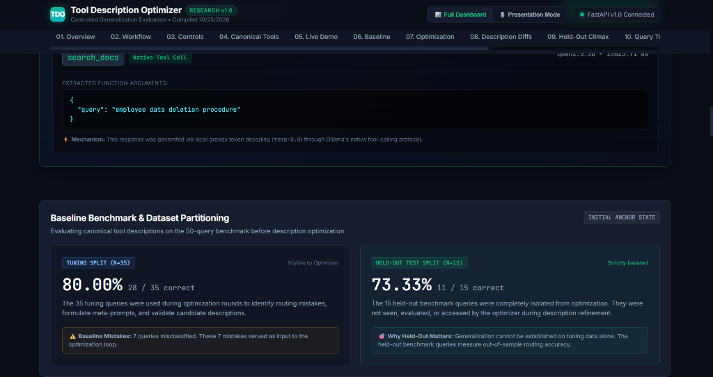
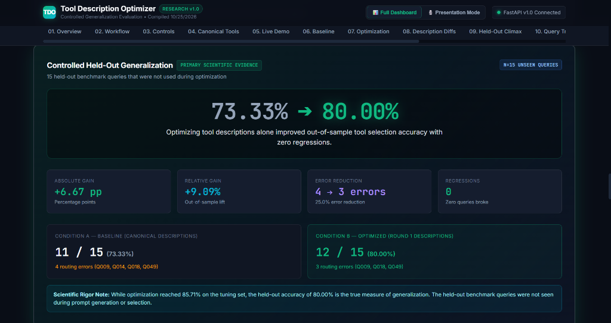

# Tool Description Optimizer

> An empirical research platform evaluating whether systematically refining natural-language tool descriptions improves AI agent tool-selection accuracy without modifying model weights, tool names, or parameter schemas.

[](#13-installation--verification)
[](#8-experimental-configuration--strict-laboratory-invariants)
[-purple.svg)](#8-experimental-configuration--strict-laboratory-invariants)
[-emerald.svg)](#9-primary-scientific-evidence-controlled-held-out-evaluation)
[](#license--provenance)

---

## 1. What is this project?

**Tool Description Optimizer** is an empirical investigation into the role of natural-language tool phrasing in local AI agent tool selection (routing).

In agentic architectures, function-calling errors are often assumed to stem from insufficient model parameter size or schema complexity. This project isolates **natural-language tool descriptions** as the single independent variable.

By keeping the underlying model (`qwen2.5:3b`), greedy temperature (`0.0`), tool names, parameter names, and schema types completely fixed, we evaluate whether optimizing description phrasing alone improves native tool-selection accuracy on 15 unseen held-out benchmark queries.

---

## 2. The Problem: Tool Selection in Agentic Systems

When an AI agent receives an operational request, its first critical decision is **tool routing**:
1. Does the query require an external tool?
2. If so, which specific tool from the available catalog should handle it?

Small, local open-weight models (such as 3B-parameter models) frequently fail when tool descriptions have overlapping, vague, or overly generic trigger conditions (e.g., `"Searches for information."` vs. `"Looks up information in documents."`). Under ambiguous phrasing, models either confuse neighboring tools or default to predicting no tool (`"none"`).

---

## 3. Research Question & Experimental Controls

> **Research Question**: *Can optimizing only natural-language tool descriptions improve an LLM's native tool-selection accuracy on unseen benchmark queries while keeping the model, temperature, tool names, and parameter schemas strictly fixed?*

### What is Fixed vs. What Changes?

| Dimension | Status | Specification |
| :--- | :---: | :--- |
| **Base Model** | 🔒 **LOCKED** | `qwen2.5:3b` (zero weights modified) |
| **Decoding Temperature** | 🔒 **LOCKED** | `0.0` (deterministic greedy token selection) |
| **Tool Count** | 🔒 **LOCKED** | Exactly 10 canonical tools + `none` (11 classes) |
| **Tool Names** | 🔒 **LOCKED** | `search_web`, `search_docs`, `read_file`, etc. |
| **Parameter Names & Types** | 🔒 **LOCKED** | Fixed JSON schema types (`string`, `integer`, etc.) |
| **Required Field Lists** | 🔒 **LOCKED** | Unaltered parameter requirement contracts |
| **Benchmark Dataset** | 🔒 **LOCKED** | 50 frozen labeled queries (35 tuning, 15 held-out) |
| **Natural-Language Descriptions** | ✏️ **MUTABLE** | **The single independent variable under study** |

---

## 4. How It Works (11-Step Experimental Pipeline)

The project executes a strictly controlled 11-step experimental protocol from canonical definition through held-out generalization testing:



### The 11 Experimental Steps

1. **Define 10 Tools (Setup)**: Establish canonical tools with locked names, parameters, schemas, and baseline descriptions.
2. **Create 50 Labeled Queries (Dataset)**: Curate operational requests across 11 classes, including 5 `none` queries.
3. **Split Dataset (Isolation)**: Partition into 35 tuning queries and 15 strictly isolated held-out test queries.
4. **Measure Baseline (Baseline)**: Anchor initial accuracy: Tuning = **80.00%** (28/35), Held-out = **73.33%** (11/15).
5. **Extract Tuning Mistakes (Analysis)**: Identify misclassified tuning queries, ground-truth labels, and confused neighbors.
6. **Generate Candidate Descriptions (Optimization)**: Use local model meta-prompter to propose clearer operational triggers and scope boundaries.
7. **Apply Guardrails (Validation)**: Enforce byte-level schema immutability, `< 40 words` length budget, and exact 4-gram copy prevention.
8. **Evaluate on Tuning Set (Testing)**: Perform deterministic greedy evaluation (`temp=0.0`) on the 35 tuning queries.
9. **Accept / Reject Candidate (Decision)**: Enforce strict improvement rule: Round 1 accepted (**85.71%**); Rounds 2 & 3 rejected (**80.00%**).
10. **Evaluate on Held-Out Set (Generalization)**: Evaluate the accepted Round 1 descriptions on the 15 unseen held-out benchmark queries.
11. **Compare Generalization (Evidence)**: Measure out-of-sample effect: **73.33% → 80.00%** (+6.67 pp, 0 regressions).

---

## 5. Agentic AI & Tool Calling Boundary

To maintain technical clarity:
- **What this project IS**: An evaluation and optimization system for the **tool routing** stage of an agent workflow (mapping user intent to the correct API tool schema via native function calling).
- **What this project IS NOT**: It is not a multi-turn autonomous coding agent running arbitrary shell commands or browser sessions in production.
- **Native Tool Calling**: Function schemas are passed directly to Ollama's `client.chat(..., tools=...)` endpoint. The model emits structured tool calls natively from token probabilities, rather than regex text parsing.

---

## 6. Live Tool Calling & Dataset Partitioning

The research platform features an interactive native function-calling console paired with a dataset partition analyzer:



### A. Live Native Tool Selection Demo
The live console executes real greedy function calling (`temp=0.0`) over local Ollama:
- **User Query**: *"Look through our internal wiki for the employee data deletion procedure"*
- **Model Selection**: `search_docs` (Native Tool Call badge)
- **Extracted Arguments**: `{"query": "employee data deletion procedure"}`
- **Observed Latency**: ~1,500–1,900 ms on consumer hardware
- **Mechanism Note**: Demonstrates native function calling directly via local Ollama without mock responses.

### B. Benchmark Dataset Partitioning (`data/queries.json`)
The benchmark consists of **50 curated operational queries** divided into two non-overlapping splits:
- **Tuning Set ($N=35$)**: Visible to the optimizer for mistake extraction and candidate validation. Baseline accuracy: **80.00%** (28/35 correct, 7 baseline mistakes).
- **Held-Out Test Set ($N=15$)**: Strictly isolated during optimization. Never exposed to the optimizer. Baseline accuracy: **73.33%** (11/15 correct, 4 baseline mistakes).
- **Held-Out Query IDs**: `Q004`, `Q008`, `Q009`, `Q014`, `Q018`, `Q022`, `Q023`, `Q028`, `Q032`, `Q036`, `Q040`, `Q041`, `Q045`, `Q049`, `Q050`.

---

## 7. The 10 Canonical Tools (`tools/tools.json`)

The 10 canonical tool definitions remain locked throughout the benchmark:

| Tool Name | Parameters | Baseline Description | Optimized Description (Round 1) | Nature of Change |
| :--- | :--- | :--- | :--- | :---: |
| `search_web` | `query: string*` | *"Searches for information."* | *"Searches the web for information."* | Domain Specified |
| `search_docs` | `query: string*` | *"Looks up information in documents."* | *"Looks up information in documents."* | Preserved |
| `read_file` | `path: string*` | *"Reads a file."* | *"Reads content from a local file path."* | Scope Clarified |
| `write_file` | `path: string*, content: string*` | *"Writes data to a file."* | *"Writes content to a specified file path."* | Scope Clarified |
| `send_email` | `recipient: string*, subject: string*, body: string*` | *"Sends a message."* | *"Sends an email message to a recipient."* | Modality Clarified |
| `create_calendar_event` | `title: string*, start_time: string*, duration_minutes: int` | *"Adds an event."* | *"Creates an event on the calendar."* | Target Specified |
| `set_reminder` | `reminder_text: string*, remind_at: string*` | *"Sets a reminder."* | *"Sets a reminder notification for a specific time."* | Scope Clarified |
| `get_weather` | `location: string*` | *"Gets weather information."* | *"Gets current weather information for a location."* | Temporal Clarified |
| `calculator` | `expression: string*` | *"Does math."* | *"Evaluates mathematical expressions and performs calculations."* | Operation Specified |
| `translate_text` | `text: string*, target_language: string*` | *"Converts text."* | *"Translates text into another language."* | Action Specified |

*\* Asterisk indicates required parameter in locked JSON Schema.*  
*(The 11th classification label is `none`, indicating that conversational or creative prompts require no external tool.)*

---

## 8. Experimental Configuration & Strict Laboratory Invariants

All evaluations adhere to deterministic experimental controls:
- **Base Model**: `qwen2.5:3b` running via local [Ollama](https://ollama.com/) ($0 API inference cost).
- **Sampling Temperature**: `0.0` (deterministic greedy decoding).
- **Inference Runs**: `1` pass per query (deterministic caching enabled).
- **Tool Schemas**: Completely immutable (types, parameter names, required lists locked).
- **Independent Variable**: Natural-language tool description text only.

---

## 9. Primary Scientific Evidence: Controlled Held-Out Evaluation

The controlled held-out experiment evaluates whether description improvements generalize to 15 benchmark queries that were **not used during optimization**:



### Controlled Held-Out Results Summary

```
========================================================================================
Partition               Condition A (Baseline)    Condition B (Optimized)    Gain / Delta
========================================================================================
Tuning Set (N=35)        80.00% (28 / 35)          85.71% (30 / 35)           +5.71 pp (+7.14% rel)
Held-Out Set (N=15) ★    73.33% (11 / 15)          80.00% (12 / 15)           +6.67 pp (+9.09% rel)
========================================================================================
★ PRIMARY SCIENTIFIC EVIDENCE: 15 held-out benchmark queries not used during optimization
```

### Key Held-Out Findings
- **Primary Metric Lift**: Accuracy improved from **73.33%** (11/15) to **80.00%** (12/15) on unseen held-out benchmark queries.
- **Absolute Gain**: **+6.67 percentage points** (`+9.09%` relative improvement).
- **Error Reduction**: Routing errors dropped from 4 to 3 (**-25.0% error reduction**).
- **Zero Regressions**: All 11 queries correct in baseline remained correct in optimized (**0 regressions**).
- **Per-Tool F1**: `read_file` F1 improved from **0.00 to 1.00**; `none` F1 improved from **0.33 to 0.40**.

---

## 10. Query-Level Routing Analysis

### Resolved Held-Out Query (`Q014` — Became Correct)
- **User Prompt**: *"Check the contents of /etc/hosts to see if the local database alias is configured."*
- **Expected Label**: `read_file`
- **Baseline Prediction**: `none` (Incorrect — missed operational action)
- **Optimized Prediction**: `read_file` (Correct — properly routed)
- **Observation**: `Q014` transitioned from `none` to `read_file` after description optimization. We report the observed prediction change without speculating about internal token activation dynamics.

### Persistent Held-Out Errors (Remained Incorrect)
1. **`Q009` (`search_docs`)**: Expected `search_docs`, predicted `none` in both conditions. The prompt asks for *"SLA tier ... in our support agreements"* without mentioning the words *"documentation"* or *"handbook"*.
2. **`Q018` (`write_file`)**: Expected `write_file`, predicted `none` in both conditions. The prompt uses the verb *"Export this list ... to disk"*, which the model did not associate with `write_file`.
3. **`Q049` (`none`)**: Expected `none`, predicted `search_web` in both conditions. Informational inquiries (*"general tips for maintaining good posture"*) triggered false-positive web search calls.

---

## 11. Threats to Validity & Limitations

To maintain scientific rigor, several methodological boundaries must be acknowledged:
1. **Small Held-Out Sample ($N=15$)**: While all 11 classes are represented, 15 queries provide evidence of improvement on this benchmark rather than universal proof across arbitrary domains.
2. **Single Model**: All evaluations used `qwen2.5:3b`. Architectural variations in larger models (e.g., Llama-3, Mistral, GPT-4o) may respond differently.
3. **Deterministic Decoding (`temp=0.0`)**: Characterizes greedy behavior; does not capture stochastic variance across non-zero temperatures.
4. **Deterministic Lexical Guardrail Limitation**: The 4-gram overlap check detects verbatim copying, but does not detect semantic paraphrasing using disjoint vocabulary.
5. **Description-Only Scope**: Schemas, parameters, and model weights were locked by design.

---

## 12. Project Structure

```text
TOOL-DESCRIPTION-OPTIMIZER/
├── backend/
│   ├── app/
│   │   ├── api/             # FastAPI REST endpoints (/health, /api/tools/select, etc.)
│   │   ├── core/            # Config, constants, exceptions, logging
│   │   ├── models/          # Pydantic schemas (evaluation, optimization, tools)
│   │   ├── services/        # OllamaService, EvaluatorService, OptimizerService, ReportService
│   │   ├── utils/           # Cryptographic hashing, metrics, validation
│   │   ├── evaluate.py      # Standalone evaluation CLI
│   │   ├── optimize.py      # Standalone optimization CLI
│   │   └── main.py          # FastAPI application entrypoint
│   ├── tests/               # 94 automated unit and integration tests (100% passing)
│   └── requirements.txt     # Python dependencies
├── frontend/
│   ├── src/                 # React 18 + TypeScript application source
│   │   ├── components/
│   │   │   ├── story/       # Phase 11 story components (Hero, Workflow, Controls, Catalog, DeepDive)
│   │   │   ├── demo/        # Live native tool selection console
│   │   │   ├── presentation/# 8-step interview stepper and speaker prompter
│   │   │   ├── evaluation/  # Held-out climax, accuracy comparison, transitions
│   │   │   ├── tools/       # Description diff table
│   │   │   └── layout/      # Header, Navigation, Footer
│   │   ├── services/        # API service and artifact loader
│   │   └── styles/          # Dark glassmorphism CSS
│   ├── public/              # Static assets (data/final_results.json, charts/)
│   ├── package.json         # Frontend dependencies and build scripts
│   └── vite.config.ts       # Vite configuration with FastAPI proxy
├── data/
│   └── queries.json         # Frozen 50-query labeled benchmark (35 tuning, 15 held-out)
├── tools/
│   └── tools.json           # Canonical 10 tool definitions
├── results/
│   ├── final_results.json   # Verified compiled research results artifact
│   ├── charts/              # High-resolution charts (SVG and PNG)
│   └── optimization/        # Sequential optimization round logs (round_00 to round_03)
├── docs/
│   ├── images/              # Visual screenshots for README and documentation
│   │   ├── experiment_workflow_11steps.png
│   │   ├── live_demo_and_baseline_split.png
│   │   └── held_out_generalization_climax.png
│   ├── architecture.md      # Detailed system architecture specification
│   ├── evaluation.md        # Benchmark and evaluator methodology
│   ├── optimization.md      # Optimization loop protocol and guardrails
│   ├── final_results_report.md # Formal research report
│   ├── interview_explanation.md # Technical interview guide (30s, 1m, 3m)
│   └── resume_description.md    # Resume bullet points and project blurbs
├── .env.example             # Environment variable template
├── .gitignore               # Clean repository tracking rules
└── README.md                # Main repository documentation
```

---

## 13. Installation & Verification

### Prerequisites
- Python 3.10+ (tested on Python 3.14)
- Node.js 18+ and npm
- [Ollama](https://ollama.com/) installed and running locally

### Step 1: Clone Repository & Setup Virtual Environment
```powershell
# Clone the repository
git clone https://github.com/your-username/TOOL-DESCRIPTION-OPTIMIZER.git
cd TOOL-DESCRIPTION-OPTIMIZER

# Create and activate Python virtual environment
py -m venv .venv
.venv\Scripts\activate

# Install backend dependencies
pip install -r backend/requirements.txt
```

### Step 2: Pull the Local LLM via Ollama
```powershell
ollama pull qwen2.5:3b
```

### Step 3: Install Frontend Dependencies
```powershell
cd frontend
npm install
cd ..
```

### Step 4: Run the Complete Backend Test Suite
```powershell
.\.venv\Scripts\pytest.exe backend\tests
# Expected output: 94 passed, 1 warning in ~45s
```

---

## 14. Running the Backend Server

Start the FastAPI application on `http://127.0.0.1:8000`:
```powershell
.\.venv\Scripts\python.exe -m uvicorn backend.app.main:app --host 127.0.0.1 --port 8000
```

Verify service health:
```powershell
curl http://127.0.0.1:8000/health
# Returns: {"status":"ok"}
```

---

## 15. Running the Frontend Dashboard

From the `frontend/` directory, start the Vite development server:
```powershell
cd frontend
npm run dev
```

Navigate to `http://localhost:5173/` in your browser to interact with the research dashboard.

---

## 16. Research Dashboard & Presentation Mode

The web application provides two distinct operational modes:

### Mode 1: Full Dashboard (`📊 Full Dashboard`)
A comprehensive research interface displaying 13 sequential story sections:
- **01. Problem Overview**: Core research question and 3-step routing pipeline.
- **02. Workflow Diagram**: 11-step experimental methodology.
- **03. Controls Split**: Locked laboratory invariants vs. mutable descriptions.
- **04. Canonical Tools**: Interactive card grid of all 10 tools + `none`.
- **05. Live Demo**: Real-time local inference with arguments and latency display.
- **06. Baseline Split**: Initial anchor comparison (80.00% vs. 73.33%).
- **07. Optimization Journey**: Progression through Rounds 0–3.
- **08. Description Diffs**: Before vs. after linguistic comparison.
- **09. Held-Out Climax**: Prominent **73.33% → 80.00%** display.
- **10. Query Transitions**: Query-by-query breakdown and Q014 case study.
- **11. Technical Deep Dive**: Collapsible 4-tab panel (11×11 confusion matrices, P/R/F1 table, SHA-256 hashes, architecture).
- **12. Limitations**: Methodological boundaries and threats to validity.
- **13. Formal Conclusion**: Approved peer-audited conclusion statement.

### Mode 2: Presentation Mode (`🎙️ Presentation Mode`)
An 8-step guided stepper tailored for live interviews and demonstrations:
- **8 Steps**: Problem $\rightarrow$ Controls $\rightarrow$ Live Demo $\rightarrow$ Baseline $\rightarrow$ Optimization $\rightarrow$ Held-Out Result $\rightarrow$ Transitions $\rightarrow$ Conclusion.
- **Speaker Prompter Drawer**: Press `N` to toggle prompter notes containing *What to Say*, *Why It Matters*, and *Trap to Avoid*.
- **Keyboard Navigation**:
  - `ArrowRight` $\rightarrow$ Next slide
  - `ArrowLeft` $\rightarrow$ Previous slide
  - `N` $\rightarrow$ Toggle speaker prompter
  - `Escape` $\rightarrow$ Exit to Full Dashboard

---

## 17. Running Evaluation (CLI)

The evaluation suite can be executed independently from the CLI:

```powershell
# Evaluate baseline tools on the tuning split (35 queries)
.\.venv\Scripts\python.exe backend\app\evaluate.py --split tuning --runs 1

# Evaluate baseline tools on the held-out split (15 queries)
.\.venv\Scripts\python.exe backend\app\evaluate.py --split held_out --runs 1 --output results/evaluation_held_out_baseline.json

# Evaluate candidate Round 1 tools on the held-out split
.\.venv\Scripts\python.exe backend\app\evaluate.py --split held_out --tools-file results/optimization/round_01.json --runs 1 --output results/evaluation_held_out_optimized.json
```

---

## 18. Running Optimization (CLI)

> **Note**: Optimization is already complete and locked. The verified scientific artifacts are frozen in [results/final_results.json](results/final_results.json).

To run the optimizer loop independently:
```powershell
.\.venv\Scripts\python.exe backend\app\optimize.py
```

---

## 19. Scientific Conclusion

> *"The controlled held-out experiment provides evidence that optimizing tool descriptions alone improved tool-selection accuracy from 73.33% to 80.00% (+6.67 percentage points, +9.09% relative) on the 15 unseen benchmark queries, with zero regressions among previously correct queries.*
>
> *Because the evaluation used only one model, one deterministic run, and 15 held-out queries, this result should be interpreted as evidence of improvement on this benchmark rather than proof of universal generalization."*

---

## License & Provenance

This research platform and dataset are provided for open academic and educational inquiry under the MIT License.  
All experimental artifacts are cryptographically verified via SHA-256 provenance digests recorded in [results/final_results.json](results/final_results.json).
